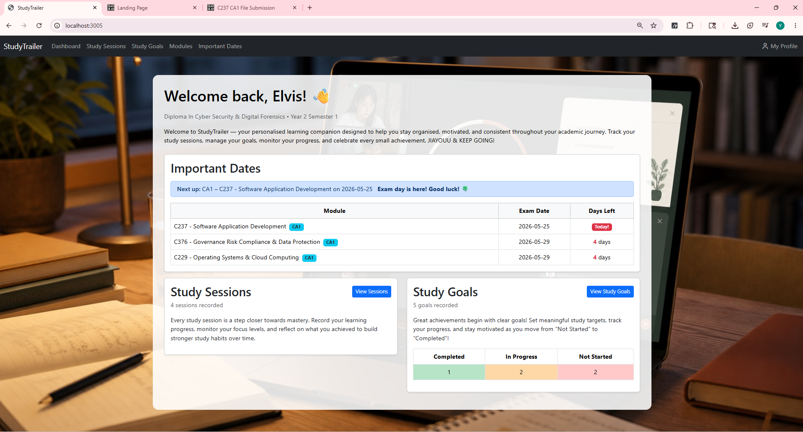
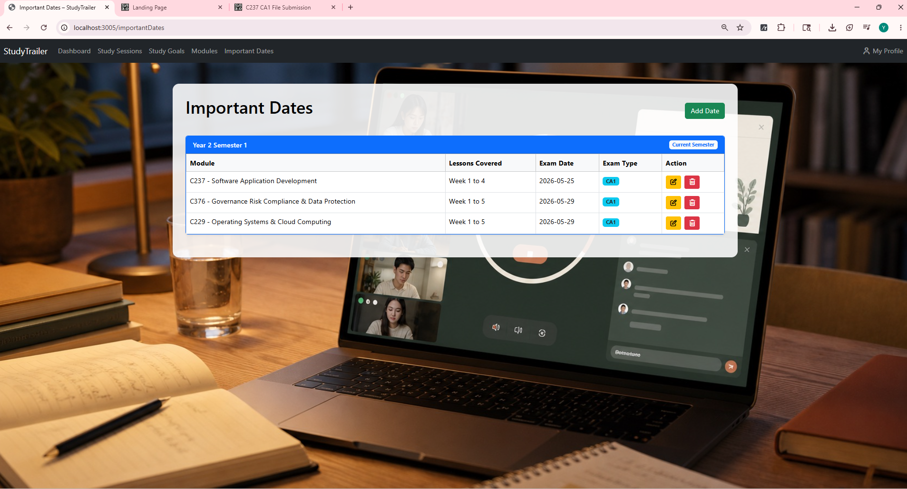
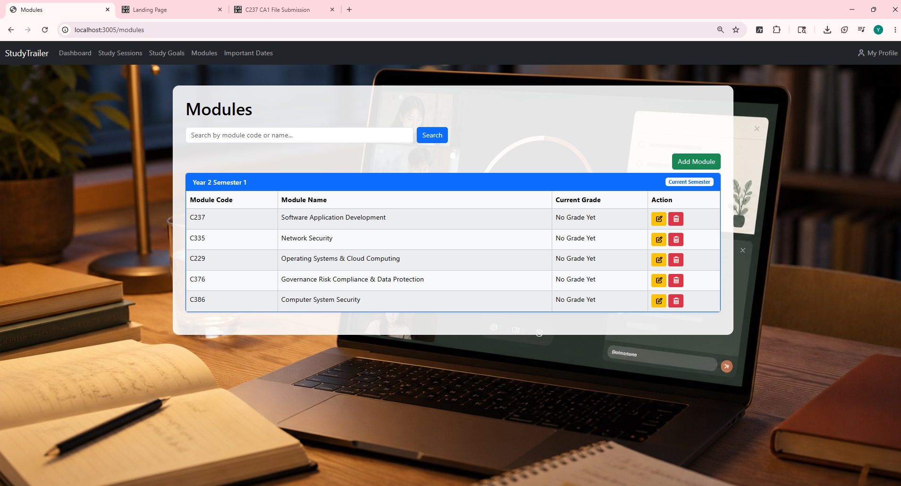
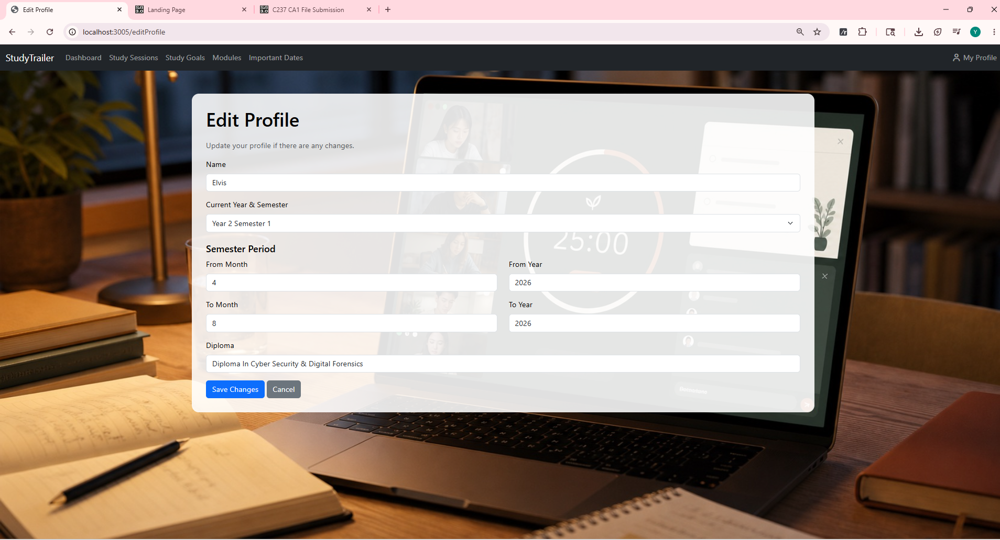
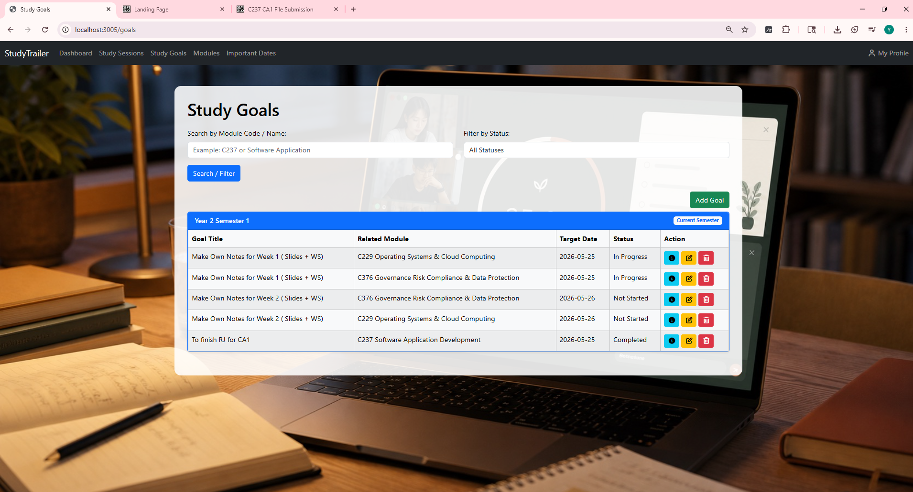
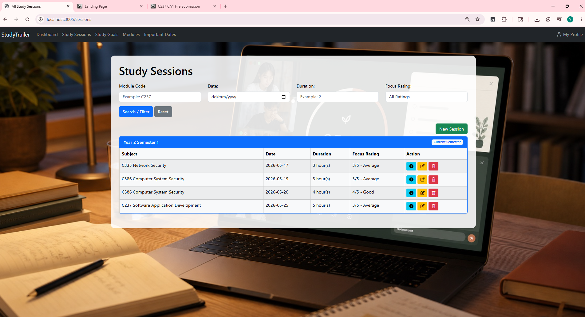

# StudyTrailer

StudyTrailer is a full-stack study management web application designed to help students stay organised and consistent throughout their studies.

Users can manage their modules, record study sessions, set study goals, track important academic dates and monitor their progress through a centralised dashboard.

## About the Project

### Project Purpose

This project was developed to apply full-stack web development concepts by creating a practical system that allows students to organise and monitor different aspects of their academic progress.

### Features

- 📊 Personalised dashboard showing upcoming dates, study sessions and goal progress
- 📚 Add, edit and manage academic modules
- 🎯 Create and track study goals by completion status
- ⏱️ Record study sessions, duration and focus ratings
- 📅 Track important assessment and examination dates
- 🔎 Search and filter study sessions, goals and modules
- 👤 Update personal and semester information

## Tech Stack

- Node.js
- Express.js
- HTML
- CSS
- JavaScript

## How to Run

1. Clone the repository:  
   `git clone https://github.com/cykethecoder/My-Study-Trailer.git`

2. Install the required dependencies:  
   `npm install`

3. Start the application:  
   `npm start`

4. Open the application in your browser at:  
   `http://localhost:3005`

## Screenshots

### Dashboard

### Important Dates

### Modules

### Profile

### Study Goals

### Study Sessions

